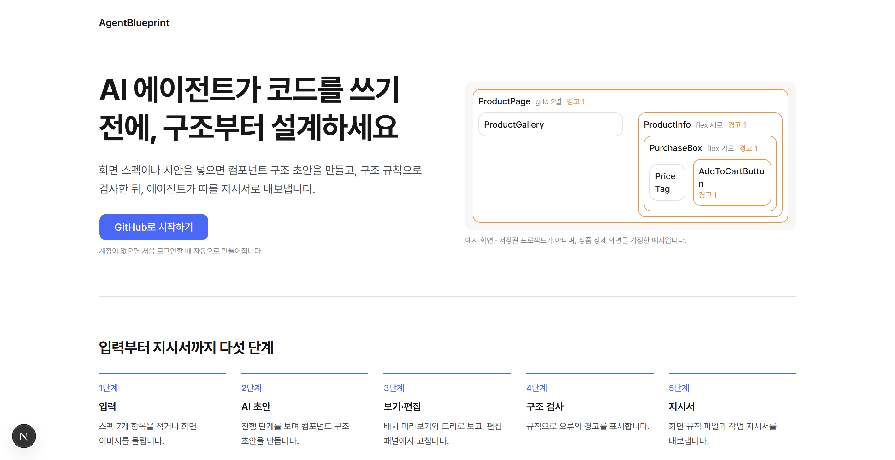
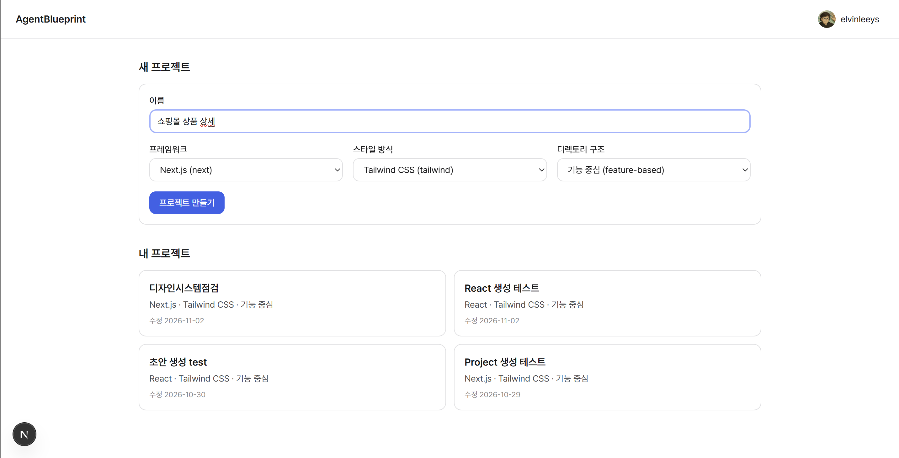
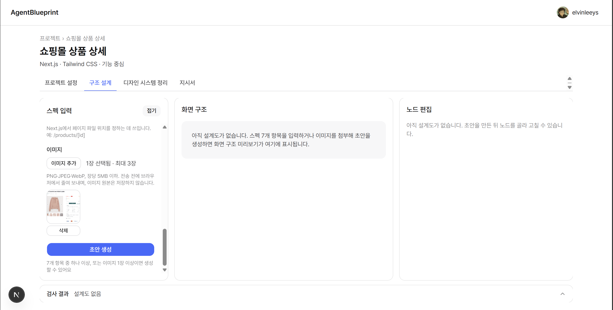
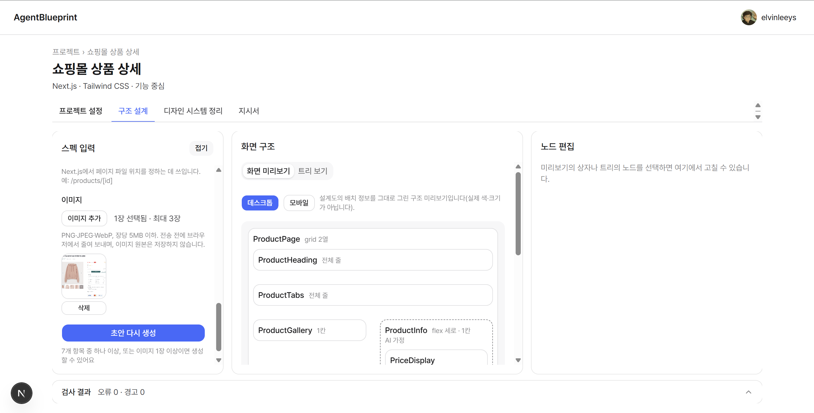
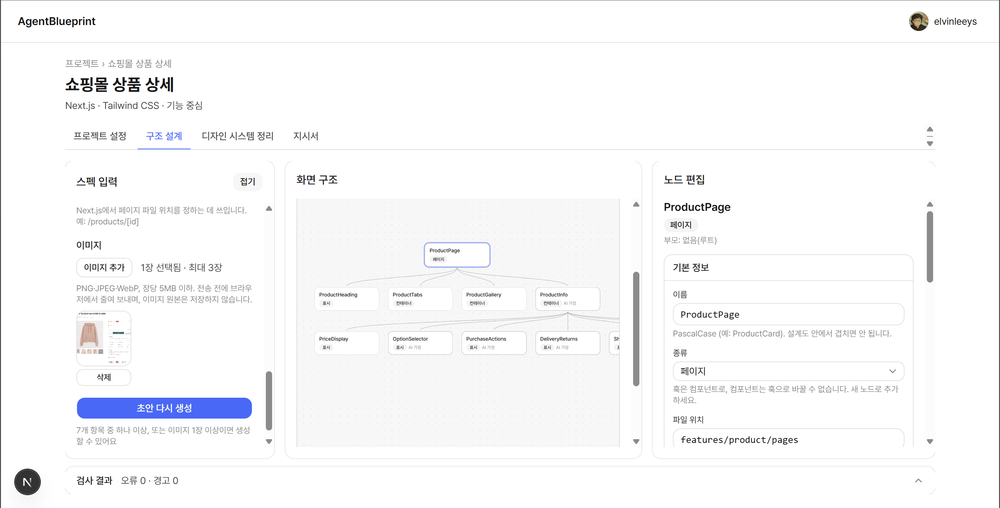
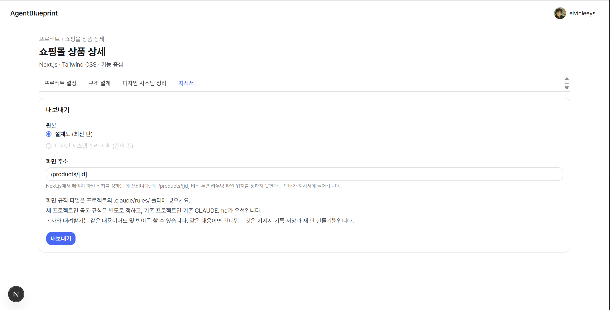
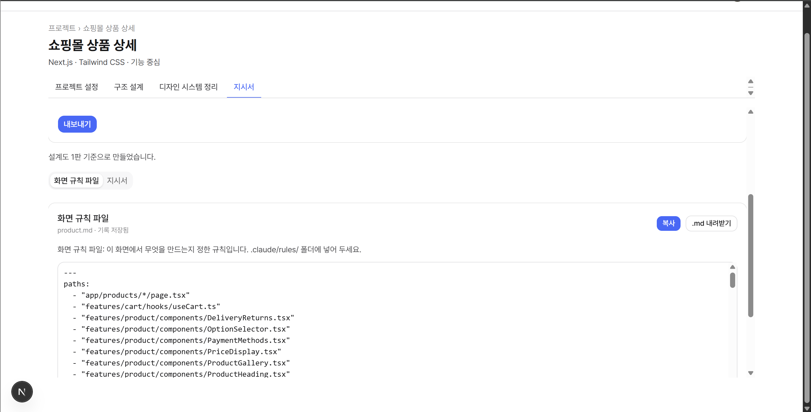

# AgentBlueprint

## 프로젝트 개요
AI agent가 코드를 생성하기 전에 해당 프로젝트를 통해 구조 설계를 돕는다.

## 사용 방법
1. [랜딩 페이지] : 'GitHub로 시작하기' 버튼 클릭을 통해 GitHub ID로 로그인

2. [프로젝트 페이지] : '프로젝트의 이름'을 입력하고 '프레임워크(NextJS / React)', '스타일 방식', '디렉토리 구조'를 선택 후 '프로젝트 만들기' 버튼 클릭

3. [구조 설계 탭] : 생성된 프로젝트 내 구조 설계 탭으로 이동하게 되고, 스펙(화면 개요, 디자인 토큰, 화면 주소 등) or 구현하려는 화면의 이미지 첨부 or 스펙 입력 및 이미지를 첨부한 후 '초안 생성' 버튼을 클릭한다. (단, 아무것도 입력하지 않을시 '초안 생성' 버튼은 클릭되지 않는다.)

4. [노드 편집] : '초안 생성' 버튼 클릭 이후 AI에 의해 구조 설계된 초안이 나타나게 된다. '화면 구조'에는 크게 2가지가 있고, '화면 미리 보기'에는 화면 구조를 예상할 수 있게 컴포넌트로 구조화된 화면이 나타나며 '트리 보기'에는 컴포넌트 구조가 계층적으로 나타나 있다. 또한 '화면 미리 보기'든 '트리 보기'에서든 컴포넌트를 선택 후 오른쪽 '노드 편집'에서 해당 컴포넌트의 정보를 편집할 수 있으며, 편집된 내용은 자동 저장된다.

5. [지시서 내보내기] : 편집된 구조 설계서는 '지시서' 탭에서 '내보내기' 버튼을 통해 2개의 파일을 생성한다. 하나는 해당 페이지의 규칙을 지정하는 '화면 규칙 파일'과 또 하나는 화면 규칙에 따라 화면을 구현하는 '지시서'이다. 이 두 파일은 내용을 복사하거나 .md 파일로 다운로드 받을 수 있다.

